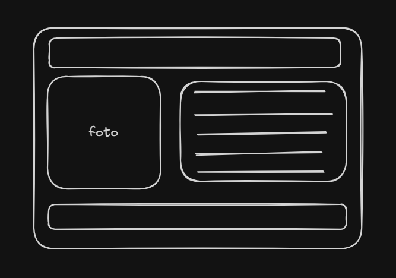

# Credencial Digital - Laboratorio Box Model

Proyecto de credencial de identificación digital desarrollado con HTML5 y CSS3 para practicar el **Box Model**, maquetación responsiva, Flexbox, pseudoelementos y animaciones suaves.

---

## Diseño Base (Wireframe en Excalidraw)

El diseño de la tarjeta de identificación fue planificado previamente en Excalidraw con la siguiente estructura visual:



### Estructura de la Credencial:
* **Cabecera (`.header`):** Franja superior con el nombre del profesional y su cargo/rol.
* **Foto de perfil (`.foto-perfil`):** Bloque lateral izquierdo que contiene la imagen del avatar y los indicadores de estado (`ONLINE` y `VERIFIED`).
  * *Fotografía utilizada:* [Ver foto original del avatar (hallowen-felipe.jpeg)](./hallowen-felipe.jpeg)
* **Información personal (`.info`):** Bloque lateral derecho con datos de contacto (ciudad, correo, tecnologías y hobbies) acompañados de iconos de FontAwesome.
* **Pie de página (`.footer`):** Franja inferior con los lemas y valores representativos.

---

## Guía de Estudio y Apuntes de CSS

A continuación se explican de forma clara, sencilla y con ejemplos prácticos cada una de las propiedades, unidades y conceptos utilizados en el código de `styles.css`.

---

## Tabla de Contenidos
0. [Diseño Base (Excalidraw)](#diseño-base-wireframe-en-excalidraw)
1. [Variables CSS y `:root`](#1-variables-css-y-root)
2. [El Modelo de Caja (Box Model) y `box-sizing`](#2-el-modelo-de-caja-box-model-y-box-sizing)
3. [Unidades: Píxeles (`px`), Porcentajes (`%`) y Viewport (`vh`)](#3-unidades-píxeles-px-porcentajes--y-viewport-vh)
4. [Posicionamiento: `relative` vs `absolute`](#4-posicionamiento-relative-vs-absolute)
5. [Pseudoelementos: `::after` y `content`](#5-pseudoelementos-after-y-content)
6. [Colores y Funciones: `rgba()` y sus valores](#6-colores-y-funciones-rgba-y-sus-valores)
7. [Sombras: `box-shadow`](#7-sombras-box-shadow)
8. [Transformaciones: `transform`, `translateY` y `scale`](#8-transformaciones-transform-translatey-y-scale)
9. [Interacciones y Estados: `:hover`](#9-interacciones-y-estados-hover)
10. [Animaciones Suaves: `transition`](#10-animaciones-suaves-transition)
11. [Layouts Modernos: Flexbox](#11-layouts-modernos-flexbox)

---

## 1. Variables CSS y `:root`

### ¿Qué es `:root`?
Es el selector que representa la raíz de todo el documento HTML (es como seleccionar `<html>`, pero con mayor prioridad). Se utiliza para declarar **variables globales** que estarán disponibles en cualquier parte de tu archivo CSS.

### ¿Cómo se declaran y cómo se usan?
* Para **crear** una variable, su nombre debe comenzar obligatoriamente con dos guiones (`--`).
* Para **usarla**, utilizas la función `var(--nombre-variable)`.

```css
/* Declaración en :root */
:root {
    --azul-oscuro: #1c3a62;
    --azul: #2b71ce;
    --verde: #05a153;
}

/* Uso en cualquier selector */
.header {
    background-color: var(--azul-oscuro);
    color: var(--verde);
}
```

> **Ventaja:** Si mañana quieres cambiar el azul corporativo de tu app, solo cambias la línea en `:root` y se actualizará automáticamente en todo tu diseño.

---

## 2. El Modelo de Caja (Box Model) y `box-sizing`

Por defecto en CSS, cuando le das a una caja `width: 200px` y luego agregas `padding: 20px` y `border: 5px`, el tamaño real en pantalla crece a `250px`. Esto solía desarmar los diseños.

```css
* {
    box-sizing: border-box;
    margin: 0;
    padding: 0;
}
```

* **`*` (Selector universal):** Aplica la regla a todas las etiquetas de la página.
* **`box-sizing: border-box;`:** Hace que el ancho (`width`) y alto (`height`) que definas **incluyan el padding y el borde**. Si dices `width: 800px;`, la caja medirá exactamente 800px sin importar cuánto padding o borde le pongas.
* **`margin: 0; padding: 0;`:** Limpia los márgenes y rellenos por defecto que traen los navegadores (como el margen por defecto de `<body>` o `<h1>`).

---

## 3. Unidades: Píxeles (`px`), Porcentajes (`%`) y Viewport (`vh`)

Hasta ahora venías usando `px`. Veamos qué significan las unidades relativas:

| Unidad | Tipo | ¿En qué se basa? | Ejemplo en tu código |
| :--- | :--- | :--- | :--- |
| **`px` (píxeles)** | Fija / Absoluta | Tamaño fijo en pantalla. No cambia con la pantalla. | `width: 800px; padding: 20px;` |
| **`%` (porcentaje)** | Relativa | En base al tamaño del **elemento padre**. | `max-width: 100%; width: 100%;` |
| **`vh` (viewport height)** | Relativa | `1vh` = 1% de la altura de la ventana del navegador. | `min-height: 100vh;` |

### Casos reales en tu código:

1. **`min-height: 100vh;` en `body`:**
   * Garantiza que el cuerpo de la página mida como **mínimo el 100% de la altura visible de la pantalla**, permitiendo que el contenido quede centrado verticalmente aunque haya poco texto.

2. **`width: 800px; max-width: 100%;` en `.credencial`:**
   * En pantallas grandes (PC): la tarjeta mide **800px**.
   * En pantallas pequeñas (celulares): la tarjeta no se sale de la pantalla, sino que se adapta ocupando como máximo el **100% del ancho disponible**.

3. **`width: 100%; height: 220px;` en `.avatar`:**
   * La imagen del avatar ocupa el **100% del contenedor padre** (`.foto-perfil`), asegurando que siempre encaje en su columna.

---

## 4. Posicionamiento: `relative` vs `absolute`

El truco de la **"caja madre e hijo flotante"**:

```css
.foto-perfil {
    position: relative; /* La caja de referencia */
}

.estado-verified {
    position: absolute; /* El elemento flotante */
    right: 8px;
    bottom: 8px;
}
```

* **`position: relative;`:** No mueve la caja de su lugar normal, pero la convierte en el **punto de anclaje** para cualquier hijo con `position: absolute`.
* **`position: absolute;`:** Saca al elemento del flujo normal del documento (flota) y lo posiciona exactamente donde le digas usando `top`, `bottom`, `left` o `right` respecto a su padre `relative`.
* **`right: 8px; bottom: 8px;`:** Ubica la etiqueta verde de "VERIFIED" a 8 píxeles de la esquina inferior derecha de la foto.

---

## 5. Pseudoelementos: `::after` y `content`

Un pseudoelemento permite crear elementos visuales desde CSS **sin necesidad de agregar más etiquetas `<div>` o `<span>` en el HTML**.

```css
.foto-perfil::after {
    content: "ONLINE";
    position: absolute;
    top: 8px;
    left: 8px;
    background-color: #3478C8;
    color: #FFFFFF;
    padding: 6px 10px;
    border-radius: 15px;
    font-size: 11px;
    font-weight: bold;
}
```

* **`::after`:** Inserta un elemento virtual justo **después** del contenido del selector.
* **`content: "ONLINE";`:** Es obligatorio en todo pseudoelemento. Define qué texto o contenido tendrá (si solo quieres una figura o decoración, se coloca vacío `content: "";`).
* Como `.foto-perfil` tiene `position: relative`, el `::after` con `position: absolute` y `top: 8px; left: 8px;` se ubica automáticamente en la esquina superior izquierda de la foto.

---

## 6. Colores y Funciones: `rgba()` y sus valores

`rgba` significa **Red, Green, Blue, Alpha (transparencia)**:

$$\text{rgba}(\text{Rojo},\ \text{Verde},\ \text{Azul},\ \text{Opacidad})$$

```css
box-shadow: 0 10px 25px rgba(0, 0, 0, 1.2);
```

### ¿Qué significa cada número?
1. **Primer valor (Rojo):** de `0` a `255`. (`0` = nada de rojo).
2. **Segundo valor (Verde):** de `0` a `255`. (`0` = nada de verde).
3. **Tercer valor (Azul):** de `0` a `255`. (`0` = nada de azul).
   * Cuando los tres son `0, 0, 0`, el color es **negro puro**.
4. **Cuarto valor (Alpha / Opacidad):** va en un rango de `0.0` (completamente transparente) a `1.0` (completamente sólido/opaco).
   * Si pones `0.2`, es un 20% visible (sombra difuminada suave).
   * Si pones `1.0`, es 100% opaco (sin transparencia).
   * **¿Qué pasó con tu `1.2` o `1.3`?** El navegador acepta el valor pero lo ajusta al límite máximo permitido (`1.0`). Por eso tu sombra se ve sólida y con mucho contraste (estilo cómic).

---

## 7. Sombras: `box-shadow`

La propiedad `box-shadow` proyecta una sombra detrás de cualquier elemento:

```css
box-shadow: 0 10px 25px rgba(0, 0, 0, 0.2);
/*          │   │    │    └── Color y transparencia
            │   │    └────── Desenfoque (Blur): qué tan difuminada es
            │   └─────────── Desplazamiento en Y (vertical): hacia abajo (+) o arriba (-)
            └─────────────── Desplazamiento en X (horizontal): hacia derecha (+) o izquierda (-) */
```

* **`0` (Eje X):** La sombra está centrada horizontalmente.
* **`10px` (Eje Y):** La sombra cae 10 píxeles hacia abajo.
* **`25px` (Blur):** Qué tan suave y expandida se dispersa la sombra.

---

## 8. Transformaciones: `transform`, `translateY` y `scale`

La propiedad `transform` modifica la posición, tamaño o rotación visual de un elemento **sin mover ni afectar a los elementos vecinos**.

### 1. Desplazamiento: `translateY()`
```css
.credencial:hover {
    transform: translateY(-10px);
}
```
* **Eje Y:** Es la línea vertical.
  * Valores positivos (`translateY(10px)`): mueven el elemento hacia **abajo**.
  * Valores negativos (`translateY(-10px)`): mueven el elemento hacia **arriba**.
* El resultado es el famoso efecto donde la tarjeta parece **"levitar" o levantarse**.

### 2. Escalado / Tamaño: `scale()`
```css
.info p:hover i {
    transform: scale(1.25);
}
```
* `scale(1)`: tamaño normal (100%).
* `scale(1.25)`: aumenta el elemento un **25% de su tamaño original** (zoom).
* `scale(0.8)`: reduciría el elemento a un 80%.

---

## 9. Interacciones y Estados: `:hover`

Una **pseudoclase** define el estilo de un elemento cuando ocurre un evento o estado del usuario.

* **`:hover`:** Se activa cuando el usuario pasa el cursor del mouse por encima del elemento.

```css
/* Cuando el mouse pasa sobre la credencial */
.credencial:hover {
    transform: translateY(-10px);
    box-shadow: 0 15px 35px rgba(0, 0, 0, 1.3);
}

/* Cuando el mouse pasa sobre el párrafo <p>, afecta al icono <i> dentro de él */
.info p:hover i {
    transform: scale(1.25);
    color: var(--verde);
}
```

> **Nota:** Puedes aplicar estilos al propio elemento hovereado (`.credencial:hover`) o a un hijo dentro de él (`.info p:hover i`).

---

## 10. Animaciones Suaves: `transition`

Por defecto, los cambios provocados por `:hover` son instantáneos y bruscos. `transition` le dice al navegador: *"no cambies de golpe, hazlo gradualmente con una animación"*.

```css
.credencial {
    transition: transform 0.3s ease, box-shadow 0.3s ease;
}

.info i {
    transition: transform 0.2s ease, color 0.2s ease;
}
```

### Estructura de `transition`:
1. **Propiedad a animar:** `transform`, `box-shadow`, `color` o `all`.
2. **Duración:** `0.3s` (300 milisegundos).
3. **Curva de aceleración:** `ease` (empieza despacio, acelera y frena suave al final).

---

## 11. Layouts Modernos: Flexbox

Flexbox sirve para alinear y distribuir elementos en una sola dimensión (fila o columna).

```css
body {
    display: flex;
    justify-content: center; /* Centrado horizontal */
    align-items: center;     /* Centrado vertical */
}
```

```css
.perfil {
    display: flex;
    align-items: center; /* Centra verticalmente la foto y la info */
    gap: 25px;           /* Espacio exacto entre la foto y la columna de texto */
}

.foto-perfil {
    flex: 0 0 220px; /* No crece, no se encoge, mide exactamente 220px */
}

.info {
    flex: 1; /* Ocupa todo el espacio restante disponible */
    min-width: 0;
}
```

---

## Resumen Rápido (Cheat Sheet)

* `position: relative` = ancla / referencia para los hijos absolutos.
* `position: absolute` = flota libre dentro del padre relativo.
* `::after` + `content: ""` = crea un elemento decorativo sin tocar el HTML.
* `rgba(R, G, B, Alpha)` = color + transparencia (`0.0` a `1.0`).
* `translateY(-10px)` = sube 10 píxeles hacia arriba.
* `scale(1.25)` = agranda un 25%.
* `:hover` = acción al pasar el mouse por encima.
* `transition: 0.3s ease` = hace que cualquier cambio en `:hover` sea suave.
